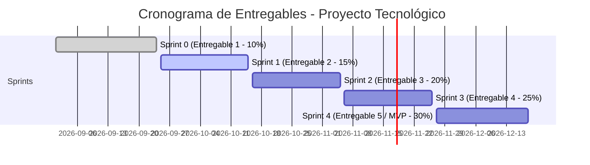

# 🧠 Memoria Viva del Proyecto: Leveling Jump
**Curso:** Proyecto Tecnológico (ISIL — NRC 30633 / Periodo 2026-2)  
**Rol Asignado:** Developers (Desarrolladores) — **Cesar Sanchez** (GitHub: [@ZombrahX](https://github.com/ZombrahX)) & Antigravity  
**Repositorio GitHub Oficial:** [https://github.com/ZombrahX/leveling-jump-system](https://github.com/ZombrahX/leveling-jump-system)

> **Regla de Identidad:** En todo documento académico, informe formal y presentación ante el docente se utiliza el nombre real **Cesar Sanchez**. El alias `ZombrahX` se reserva exclusivamente para la URL del repositorio y usuario de GitHub.

---

## 1. Bitácora de Decisiones Técnicas y de Negocio

### 1.1 Contexto Real de Negocio (Insights refinados de la entrevista)
- **Cliente:** *Leveling Jump* (Dueño: Roberto).
- **Flujo de Abastecimiento:** Lotes de productos recibidos **aproximadamente dos veces al mes** de importaciones internacionales (Gundam, model kits, figuras coleccionables).
- **Dinámica de Ventas:**
  - **Sábados:** Ferias presenciales de coleccionismo (requiere interfaz rápida desde celular o tablet).
  - **TikTok:** Ventas en transmisiones en vivo y **subastas en tiempo real** (el stock cambia en segundos; si no se descuenta al instante, se vende dos veces).
  - **Facebook:** Pedidos por inbox.
  - **WhatsApp:** Canal de difusión para medir interés de importaciones futuras (Hype / Intención de compra).
- **El Dolor Principal (Pain Point):** Manejaban todo en Excel. Ocurrió un incidente crítico donde vendieron un producto ya agotado por no tener el inventario sincronizado entre TikTok y las ferias, obligando a devolver dinero, pagar compensaciones y perder clientes.
- **Flujo de Reservas:** Registro del monto de adelanto abonado y el saldo pendiente. Cuando llega el lote, pagan el saldo restante y se despacha por **Olva Courier / Shalom** o se entrega en la **Feria de los Sábados**.

---

## 2. Decisiones de Arquitectura y Stack Concreto

| Decisión | Elección Concreta | Estado | Justificación Técnica ante el Evaluador |
| :--- | :--- | :---: | :--- |
| **Frontend** | React.js con Vite + Tailwind CSS | Propuesto | SPA rápida, reactiva y responsive para ferias y escritorio. |
| **Backend** | Node.js + Express.js | Propuesto | I/O no bloqueante, óptimo para manejar peticiones concurrentes de stock. |
| **Base de Datos** | PostgreSQL (en Supabase) | Propuesto | Garantiza transacciones ACID con bloqueo de registros (row locking). |
| **ORM** | Prisma ORM | Propuesto | Tipado estricto y migraciones controladas. |
| **Control de Versiones** | GitHub (`main`, `develop`) | **Configurado** | Repositorio oficial creado con estrategia Git Flow y PRs. |
| **Gestión Ágil** | Jira Software | **Configurado** | Tablero Scrum habilitado para gestión del Backlog y Dailies. |
| **Diseño UI/UX** | Figma | Propuesto | Prototipado colaborativo de flujos y componentes visuales. |
| **Despliegue Staging/Prod** | Vercel (Front) + Render (API) | Propuesto | Entornos cloud para CI/CD y demostraciones en vivo de Sprint Review. |

---

## 3. Estado de Entregables e Hitos del Curso



### ✅ Sprint 0 (Entregable 1 — Semana 4 / Ponderación: 10%) — [CULMINADO]
- [x] Repositorio de GitHub creado y configurado: `https://github.com/ZombrahX/leveling-jump-system`.
- [x] Stack tecnológico definido y justificado técnicamente.
- [x] Diagrama de Arquitectura de Software creado y exportado (`04_Diagramas_y_Diseno/diagrama_arquitectura_software.png`).
- [x] Modelo Entidad-Relación de Base de Datos diseñado y exportado (`04_Diagramas_y_Diseno/diagrama_modelo_datos_er.png`).
- [x] Documento Word generado listo para integrar: `03_Entregables_e_Informes/APORTE_DEVELOPERS_SPRINT_0.docx`.
- [x] Redacción completa de la **Sección 3.0.2** lista para el informe: `03_Entregables_e_Informes/SECCION_3_0_2_ARQUITECTURA_Y_ENTORNO.md`.
- [x] Redacción de la **Definition of Done (DoD)** para la Sección 3.0.3.
- [x] **Referencias Bibliográficas Globales (APA 7):** Generadas en `03_Entregables_e_Informes/REFERENCIAS_APA7_PROYECTO_COMPLETO.docx` y `.md` cubriendo todo el marco metodológico y técnico del proyecto.

---

### ✅ Sprint 1 (Entregable 2 — Semana 7 / Ponderación: 15%) — [CULMINADO Y ENTREGADO]
**Sprint Goal:** *"Desarrollar una primera versión funcional del catálogo de productos (público y administrativo) y la recepción de lotes de importación para Leveling Jump."*  
* **Hash de Entrega Oficial:** `[develop / f9a30e6]` (`f9a30e672ab370f158793b511ec9c15787934685`)
* **Estado:** 100% de historias de usuario integradas, probadas y expuestas con éxito en la demo ante el docente (HU-01, HU-03, HU-04).

---

### 🚀 Sprint 2 (Entregable 3 — 12 oct al 02 nov / Ponderación: 20%) — [EN CURSO]
**Sprint Goal:** *"Implementar el sistema integral de autenticación con control de roles y permisos (SUPERADMIN, ADMIN, CLIENTE), auditoría de recepción de lotes con fechas físicas y documentos, alertas de rentabilidad (precio menor al costo) y módulo transaccional de reservas de stock con adelanto manual."*

#### A. Historias de Usuario Aprobadas en Jira (PTLJ Sprint 2)

| Jira ID | HU | Descripción Resumida | Estimación | Responsable Principal |
| :--- | :--- | :--- | :---: | :--- |
| `PTLJ-43` | **HU-11** | **Autenticar usuarios por rol:** Login con JWT, contraseñas seguras y verificación real de correo (Google OAuth + OTP). Control de acceso por rol (`SUPERADMIN`, `ADMIN`, `CLIENTE`) y permisos por módulo. | 5 pts | **Cesar Sanchez** |
| `PTLJ-44` | **HU-12** | **Diferenciar fecha de llegada y de registro:** Registro de la fecha física real de arribo de mercadería vs. fecha/hora inmutable de registro en el sistema, más número de documento (factura/guía). | 3 pts | **Cesar Sanchez** |
| `PTLJ-45` | **HU-13** | **Alertar precio menor al costo:** Alerta visual y aviso de margen negativo si el precio de venta en catálogo es menor al costo de adquisición del lote. | 3 pts | **Cesar Sanchez** |
| `PTLJ-4` | **HU-06** | **Reservar producto:** Reserva de unidades físicas disponibles con código de seguimiento único (`RES-2026-XXXX`), registro de adelanto manual y cálculo de saldo pendiente. | 5 pts | **Cesar Sanchez** |

#### B. Arquitectura de Base de Datos Implementada en Supabase (Sprint 2)
1. **Tabla `usuarios`:**
   * Soporte de roles jerárquicos: `SUPERADMIN` (dueño, no eliminable por otros admins), `ADMIN` (staff de operaciones), `CLIENTE` (comprador).
   * Método de registro (`metodo_registro`): `LOCAL` (correo + contraseña con código OTP) o `GOOGLE` (Google OAuth con correo verificado).
   * Campo `permisos_modulos` (JSON) para delegación granular de funciones a miembros del staff.
2. **Tabla `reservas`:**
   * Código de seguimiento único, relación con unidad física (`id_unidad_inventario`) y cliente (`id_usuario`).
   * Desglose financiero: `monto_total`, `monto_adelanto` (flexible sin porcentaje forzado) y `saldo_pendiente`.
   * Estados de ciclo de vida: `PENDIENTE`, `CONFIRMADA`, `ENTREGADA`, `CANCELADA`, `EXPIRADA`.
3. **Ampliación de `lotes_ingreso`:**
   * `documento_referencia` (VARCHAR 50) para facturas o guías de remisión.
   * `fecha_llegada` (DATE) independiente de `fecha_creacion` (TIMESTAMP audit).

---

#### C. Historias de Usuario del Sprint 1 (Histórico Completado)

---

##### 1. HU-03: Gestionar productos del catálogo (Panel Administrativo)
| ID Tarea | Tarea | Rol | Responsable | Estimado | Estado |
| :--- | :--- | :--- | :--- | :---: | :---: |
| `HU03-T01` | Definir campos y reglas del producto | PO + Desarrollador | Brian | 1.5 h | ✅ Listo |
| `HU03-T02` | Diseñar modelo de datos | Backend | **Cesar Sanchez** | 2.0 h | ✅ Listo |
| `HU03-T03` | Crear migración en Prisma | Backend | **Cesar Sanchez** | 1.5 h | ✅ Listo |
| `HU03-T04` | Implementar API de registro | Backend | Adriano | 3.0 h | ✅ Listo (`develop`) |
| `HU03-T05` | Implementar API de consulta y búsqueda | Backend | Adriano | 2.5 h | ✅ Listo (`develop`) |
| `HU03-T06` | Implementar API de actualización | Backend | Adriano | 2.0 h | ✅ Listo (`develop`) |
| `HU03-T07` | Diseñar interfaz administrativa | Frontend / UX | Zuriel | 3.0 h | 🔄 En curso (`frontend`) |
| `HU03-T08` | Implementar listado y buscador | Frontend | Zuriel | 3.0 h | 🔄 En curso (`frontend`) |
| `HU03-T09` | Implementar formulario registro/edición | Frontend | Zuriel | 3.0 h | 🔄 En curso (`frontend`) |
| `HU03-T10` | Integrar frontend y backend | Fullstack | **Cesar**, Adriano, Zuriel | 2.5 h | ⏳ Pendiente |
| `HU03-T11` | Ejecutar pruebas de aceptación | PO + Dev | Brian, Adriano | 2.0 h | ⏳ Pendiente |
| `HU03-T12` | Documentar evidencias | Scrum Master | Renato | 1.5 h | ⏳ Pendiente |

---

##### 2. HU-04: Recepción y registro de lotes de importación
| ID Tarea | Tarea | Rol | Responsable | Estimado | Estado |
| :--- | :--- | :--- | :--- | :---: | :---: |
| `HU04-T01` | Definir campos y reglas de recepción | PO + Desarrollador | Brian | 1.0 h | ✅ Listo |
| `HU04-T02` | Diseñar modelo de datos (Lote, Inventario) | Backend | **Cesar Sanchez** | 2.0 h | ✅ Listo |
| `HU04-T03` | Crear migración en Prisma | Backend | **Cesar Sanchez** | 1.5 h | ✅ Listo |
| `HU04-T04` | Implementar API de registro de recepción | Backend | Adriano | 3.0 h | ✅ Listo (`develop` - `067b10f`) |
| `HU04-T05` | Implementar generación de unidades de inventario | Backend | Adriano | 2.5 h | ✅ Listo (`develop` - `067b10f`) |
| `HU04-T06` | Implementar validación de cantidad obligatoria | Backend | Adriano | 1.0 h | ✅ Listo (`develop` - `067b10f`) |
| `HU04-T07` | Diseñar interfaz de registro de recepción | Frontend / UX | Zuriel | 2.5 h | ✅ Listo (`frontend` - `2563457`) |
| `HU04-T08` | Implementar formulario de recepción de lotes | Frontend | Zuriel | 3.0 h | ✅ Listo (`frontend` - `2563457`) |
| `HU04-T09` | Integrar frontend y backend | Fullstack | **Cesar**, Adriano, Zuriel | 2.0 h | 🔄 **En curso (Alinear rutas y payloads)** |
| `HU04-T10` | Ejecutar pruebas de aceptación | PO + Dev | Brian, **Cesar Sanchez** | 1.5 h | ⏳ Pendiente |
| `HU04-T11` | Documentar evidencias | Scrum Master | Renato | 1.0 h | ⏳ Pendiente |

---

##### 3. HU-01: Catálogo público de productos y disponibilidad para clientes
| ID Tarea | Tarea | Rol | Responsable | Estimado | Estado |
| :--- | :--- | :--- | :--- | :---: | :---: |
| `HU01-T01` | Definir criterios de visualización y filtros | PO + Desarrollador | Brian | 1.0 h | ✅ Listo |
| `HU01-T02` | Implementar API de consulta pública | Backend | Adriano | 2.0 h | ✅ Listo (`develop` - `GET /api/productos`) |
| `HU01-T03` | Implementar filtro/búsqueda por nombre y cat. | Backend | Adriano | 1.5 h | ✅ Listo (`develop` - `GET /api/productos`) |
| `HU01-T04` | Diseñar interfaz del catálogo público | Frontend / UX | Zuriel | 2.0 h | ✅ Listo (`frontend` - `PublicCatalog.jsx`) |
| `HU01-T05` | Implementar listado con estado de disponibilidad | Frontend | Zuriel | 2.5 h | ✅ Listo (`frontend` - `PublicCatalog.jsx`) |
| `HU01-T06` | Implementar buscador en frontend | Frontend | Zuriel | 1.5 h | ✅ Listo (`frontend` - `PublicCatalog.jsx`) |
| `HU01-T07` | Integrar frontend y backend | Fullstack | Adriano, Zuriel | 1.5 h | 🔄 **En curso** |
| `HU01-T08` | Ejecutar pruebas de aceptación | PO + Dev | Brian, Zuriel | 1.0 h | ⏳ Pendiente |
| `HU01-T09` | Documentar evidencias | Scrum Master | Renato | 0.5 h | ⏳ Pendiente |

---

#### B. Resumen de Carga y Avance de Cesar Sanchez en Sprint 1
* **Total Horas Asignadas:** **13.0 horas** en el Sprint 1 Planning.
* **Horas Completadas:** **7.0 horas** (`HU03-T02`, `HU03-T03`, `HU04-T02`, `HU04-T03` — Modelado y despliegue de toda la persistencia relacional en Supabase).
* **Horas en Ejecución / Próximas:** **6.0 horas**  
  * `HU03-T10` (2.5 h): Integración fullstack del catálogo de productos.
  * `HU04-T09` (2.0 h): Integración de endpoints de recepción de lotes con formularios de Zuriel.
  * `HU04-T10` (1.5 h): Pruebas funcionales de aceptación con Brian.

---

## 5. Puntos Clave para la Integración Frontend ↔ Backend (Cesar, Adriano, Zuriel)

Del análisis cruzado de las ramas `develop` y `frontend` se identificaron las siguientes tareas de acoplamiento:
1. **Ruta del Endpoint de Recepción:**  
   * En Frontend (`recepcionService.js` de Zuriel): Llama a `POST http://localhost:4000/api/recepciones`.  
   * En Backend (`loteRoutes.js` de Adriano): Está escuchando en `POST http://localhost:4000/api/lotes`.  
   * *Acción:* Ajustar la URL del frontend a `/api/lotes` o agregar alias en Express.
2. **Payload de Recepción de Lotes:**  
   * Adriano espera: `{ codigoLote, proveedor, observaciones, idProducto, cantidad, costoUnitario }`.  
   * Zuriel envía: `{ productoId, cantidad, fechaRecepcion, observaciones }`.  
   * *Acción:* Unificar que se envíe `codigoLote`, `proveedor`, `idProducto`, `cantidad`, `costoUnitario`.
3. **Cálculo de Stock en Catálogo:**  
   * Zuriel preparó el catálogo público para mostrar un badge de stock si el backend envía `stockDisponible` o `unidadesDisponibles`.  
   * *Acción:* En `productController.js`, incluir en `findMany` el conteo de `unidadesInventario` donde `estadoStock === 'DISPONIBLE'`.

---

## 4. Estructura Organizada del Directorio

```text
📁 PROYECTO TECNOLOGICO (SRM)/
├── 📁 01_Clases_y_Guias_ISIL/       # PDFs de guía, rúbricas y PPTs de clases semanales
├── 📁 02_Relevamiento_y_Negocio/    # Entrevistas con Leveling Jump, gdocs y backlog inicial
├── 📁 03_Entregables_e_Informes/    # Word (.docx) y Markdown (.md) de los avances técnicos
├── 📁 04_Diagramas_y_Diseno/        # Imágenes PNG y assets visuales de arquitectura y BD
├── 📁 scripts/                      # Scripts auxiliares y generadores de documentos
├── 📄 GUIA_Y_REGLAS_ROL_DEVELOPERS.md # Reglas y rúbricas del rol de desarrollador
└── 📄 MEMORIA_DEL_PROYECTO.md       # Bitácora viva y decisiones técnicas del proyecto
```

---

## 5. Reglas Críticas para no Perder Puntos en las Revisiones

1. **Regla de los 5 Accesos:** En la rúbrica del Entregable 1 se revisa que los 5 integrantes tengan acceso operativo a GitHub y Jira. Si falta uno, baja puntaje.
2. **Cero Diapositivas en la Demo:** La sustentación dura 10 minutos; máximo 1 minuto de introducción y los otros 9 minutos son **navegando en vivo sobre las herramientas y el código**.
3. **Transparencia en IA:** Está permitido usar IA para desarrollo, pero los Devs debemos explicar con nuestras propias palabras la lógica de cada función o tabla si el profesor pregunta.

---

## 6. Sprint 2: Autenticación Real, Jerarquía de Staff, Trazabilidad de Lotes y Reservas (12 Oct - 2 Nov)

En este Sprint se abordaron los requerimientos críticos de seguridad, negocio y experiencia de usuario acordados para Leveling Jump:

### 1. HU-11 (PTLJ-43): Autenticación con Verificación de Correo Real (OTP) y Google OAuth
* **Servicio SMTP Transaccional:** Configurado con Gmail (`ashco214@gmail.com`) y App Password de 16 caracteres.
* **Verificación Real de Correo (OTP):** Generación de token numérico de 6 dígitos con expiración de 15 minutos y plantilla HTML corporativa de Leveling Jump. Se elimina el ingreso ficticio "click-and-pass", garantizando cuentas legítimas.
* **Integración Oficial Google Cloud OAuth 2.0 (Google Auth Platform):**
  - **Proyecto Google Cloud:** `braided-trees-384500` (My First Project)
  - **Client ID:** Configurado de forma segura en variables de entorno locales (`VITE_GOOGLE_CLIENT_ID`).
  - **Client Secret:** Resguardado en servidor y `.env` bajo `GOOGLE_CLIENT_SECRET`.
  - **Tipo de Aplicación:** Aplicación Web (SPA con `@react-oauth/google`)
  - **Orígenes autorizados de JavaScript:** `http://localhost:5173`
  - **URIs de redireccionamiento autorizados:** `http://localhost:5173`
  - **Fecha de Creación:** 15 de octubre de 2026, 3:36:35 p. m. GMT-5
  - **Archivo JSON respaldado:** Archivo de credenciales resguardado localmente y protegido en `.gitignore` para no exponer credenciales en repositorios públicos.
  - **Configuración de Variables de Entorno:**
    - `frontend/.env`: `VITE_GOOGLE_CLIENT_ID` (OAuth Web Client)
    - `.env` (raíz): Respaldo seguro de credenciales backend.
  - **Gestión de Consentimiento y Usuarios de Prueba (Testing vs Producción):**
    - Durante la fase de desarrollo/prueba con estado *"En prueba"* en Google Cloud Console, Google restringe el acceso OAuth únicamente a los correos añadidos en la sección **Pantalla de consentimiento de OAuth ➔ Usuarios de prueba (Test users)** (ej. `ashco214@gmail.com`, `cesar.sanchez@isil.pe`).
    - Al publicar la aplicación o registrar los correos de prueba, el popup nativo de Google (`accounts.google.com`) procesa el inicio de sesión permitiendo seleccionar cualquiera de las cuentas activas en el navegador.
* **Jerarquía de Accesos y Seguridad Inmutable:**
  * `SUPERADMIN`: Cuenta propietaria de César Sánchez (`cesar.sanchez@isil.pe`). Posee control total sobre inventario, staff y configuraciones.
  * **Regla Inmutable:** Ningún miembro de staff puede suspender ni eliminar la cuenta del Superadministrador (protección validada en capa de base de datos y endpoints Express).
  * `ADMIN` (Staff): Personal de tienda/feria con permisos modulares configurables (`PRODUCTOS`, `LOTES`, `RESERVAS`).
  * `CLIENTE`: Vista pública por defecto con exploración de catálogo y reservas.

### 2. HU-12 (PTLJ-44): Trazabilidad Temporal y Documental de Lotes
* **Separación de Fechas:** Se incorporó el campo `fechaLlegada` (fecha física en que la mercadería llegó al almacén o taller) diferenciado de `fechaCreacion` (marca temporal inmutable del sistema).
* **Documento de Referencia:** Registro de `documentoReferencia` (Factura comercial, Boleta de importación o Guía de remisión del flete).
* **Historial de Lotes:** Tabla en vivo en la interfaz de recepción con los últimos lotes recibidos y sus unidades generadas.

### 3. Pulido HU-04 (Recepción de Lotes)
* **Proveedor Limpio:** Se eliminó el valor predeterminado estático (`Bandai Namco Importaciones`), permitiendo el ingreso limpio de cualquier distribuidor.
* **Memoria de Borrador (`localStorage`):** Almacenamiento reactivo del formulario de recepción. Si el usuario necesita pausar la recepción para crear un producto nuevo en el catálogo, sus datos y unidades quedan intactos al regresar.

### 4. HU-13 (PTLJ-45): Alerta de Margen Negativo
* En el formulario de productos, el sistema coteja en tiempo real el precio de venta propuesto frente al costo unitario de adquisición registrado en los lotes (`costoReferencia`).
* Si el precio es menor al costo, se despliega una alerta visual no bloqueante advirtiendo la pérdida económica por unidad.

### 5. HU-06 (PTLJ-4): Sistema de Reservas Comerciales y Políticas de Adelanto
* **Módulo Accesible y Transaccional:** Disponible desde el catálogo para apartar kits antes de que se agoten en transmisiones de TikTok Live o ferias presenciales.
* **Doble Entrada Sincronizada (Soles S/ y Porcentaje %):** El comprador o administrador puede ingresar el valor en moneda (S/ con decimales) o en porcentaje con precisión decimal (ej. `17.9%`, `71.67%`), calculándose mutuamente en tiempo real junto con el saldo pendiente contra entrega.
* **Privacidad y Permisos de Configuración Exclusivos para Staff:** El botón y cajón de configuración (`⚙️ Personalizar %`) está reservado estrictamente para usuarios con rol `ADMIN` o `SUPERADMIN`. Los compradores y visitantes regulares solo ven las opciones comerciales finales de pago, protegiendo las políticas operativas del negocio.
* **Soporte de 3 Casos Comerciales de Reserva:**
  1. **Caso 1 (Estándar / Flexible):** Ofrece 3 tramos de adelanto (Mínimo configurable, Intermedio configurable y Pago Total 100%). Diseñado para la mayoría de kits (HG, RG, MG estándar). Permite definir porcentajes personalizados como 17.9% o 71.67% según estrategia comercial.
  2. **Caso 2 (Económico / Intermedio - Mínimo 50%):** Ofrece 2 tramos de adelanto (50% y 100% Total). Aplica a kits o accesorios de bajo costo donde un adelanto menor (como 20%) comprometería stock por montos ínfimos.
  3. **Caso 3 (Exclusivo / Pedido Especial - 100% Pago Total):** Ofrece 1 solo tramo obligatorio del 100% (Pago Total). Bloquea adelantos fraccionados y fija el monto total para kits P-Bandai de alta demanda, figuras prémium de resina o preventas especiales.
* **Gestión por Producto y Aplicación Global ("Aplicar a todos"):**
  - **Edición por Producto:** El staff puede definir la política individual de un kit al registrarlo/editarlo en el formulario maestro o directamente desde el modal de reserva con el botón *"Guardar para este producto"*.
  - **Aplicación Global:** El botón formal *"Aplicar a todos"* permite fijar una regla general a todos los productos del catálogo sin tocar código ni ejecutar scripts SQL en la base de datos, manteniéndose sincronizado en el servicio `reservaPoliticaService`.
* **Doble Modo Operativo Sobrio para Staff:**
  - El personal de tienda/administrador puede crear reservas a su nombre (*Auto-reserva (Para mí)*) o **a nombre de clientes terceros** (*A nombre de un Cliente*), registrando el nombre y WhatsApp del comprador real mientras el sistema audita qué miembro del staff gestionó la separación.
* **Código Correlativo Inmutable:** Asignación automática de tracking `RES-2026-XXXX`.
* **Notificación Oficial Multicanal:** Envío del comprobante formal por correo vía Gmail SMTP y generación inmediata de enlace directo a WhatsApp con mensaje preformateado para coordinación del retiro y pago del saldo restante.

### 6. Criterio de Presentación Profesional y Experiencia de Usuario
* **Erradicación de Siglas Técnicas en la UI:** Las siglas de gestión ágil (`HU-XX`, `PTLJ-XX`) pertenecen estrictamente a la documentación de Jira y la bitácora técnica. Las pantallas de la aplicación emplean terminología comercial, sobria y limpia apta para la sustentación y demostración comercial.
* **Soporte de Múltiples Superadministradores:** El Superadministrador principal puede designar a otros usuarios con rol `SUPERADMIN` (Administrador General) con acceso total a los módulos si se requiere co-administración, manteniendo blindada la cuenta del Propietario Principal (`cesar.sanchez@isil.pe` / ID 1) contra suspensiones.
* **Ordenamiento Interactivo por Columnas:** Estandarizado con indicadores de dirección (`▲` / `▼`) tanto en el catálogo de productos como en el historial de lotes recibidos.

### 7. Arquitectura de Navegación Empresarial y Bolsa de Reservas en Masa
* **Barra de Navegación Empresarial (Dropdown Menus vs. Barra Desbordada):**
  - La navegación principal fue rediseñada para reemplazar la barra horizontal estática que producía barras de desplazamiento lateral incómodas al crecer el sistema.
  - Se estructuró en menús desplegables agrupados por dominio funcional:
    1. **Catálogo & Tienda:** *Catálogo Comercial* (para compradores/público) y *Gestión de Productos* (catálogo maestro, edición y precios).
    2. **Almacén & Lotes:** *Recepción de Lotes* (ingreso físico, cálculo de flete y control de series).
    3. **Ventas & Reservas:** *Control de Reservas* (auditoría de adelantos, saldos pendientes y retiros).
    4. **Administración:** *Gestión de Staff* (exclusivo para Superadministradores).
  - Incluye cierre por click fuera del área (`click-outside`), indicadores visuales del módulo activo, animaciones de apertura y diseño responsivo sin scrollbars forzados.
* **Sistema de "Bolsa de Reserva" (Reservas en Masa):**
  - **Operación Multiproducto Integrada:** Desde el catálogo comercial, cada producto cuenta con el botón `➕ Bolsa`, permitiendo añadir o retirar kits de la canasta sin perder el flujo unitario rápido (`🔖 Reservar`).
  - **Indicador Flotante y de Cabecera:** Contador interactivo `🛒 Bolsa de Reserva (N kits)` que persiste la selección en `localStorage` ante recargas de página.
  - **Modal Consolidado (`MultiReservationModal`):**
    - Desglose unitario con miniaturas, precios y la política individual de cada kit (ej. Kit A con política 20%, Kit B con 50%, Kit C con 100% Pago Total).
    - Sumatoria automática del Monto Total de Compra y del Adelanto Mínimo Requerido Combinado.
    - Distribución inteligente del abono y cálculo del saldo pendiente total contra entrega.
    - Emisión en lote de reservas con tracking individual y generación de mensaje unificado de WhatsApp que detalla todos los kits reservados y sus respectivos códigos.

### 8. Autogestión del Cliente: Módulo de Perfil y Consulta de Reservas Propias
* **Módulo de Perfil de Usuario (`UserProfile.jsx`):**
  - Permite a cualquier usuario registrado (tanto clientes como miembros de staff) consultar y actualizar sus datos de contacto en tiempo real sin requerir acceso manual a la base de datos SQL.
  - Incorpora la edición de su **Teléfono o WhatsApp de contacto**, el cual no es provisto por defecto por Google OAuth. Al guardarlo en el endpoint `PUT /api/auth/perfil`, el número queda vinculado permanentemente a su cuenta y se precarga de manera automática en el modal de reserva para agilizar futuros pedidos.
* **Módulo de Consulta de Reservas del Cliente (`CustomerReservations.jsx`):**
  - Resuelve la necesidad del comprador que no revisa habitualmente su correo electrónico, permitiéndole ver directamente en la plataforma web el estado en vivo de todos los kits apartados a su nombre.
  - Muestra tarjetas individuales con fotografía, código de tracking correlativo (`RES-2026-XXXX`), desglose de adelanto registrado vs. saldo pendiente contra entrega, y botón directo para coordinar la entrega por WhatsApp.
  - Filtros interactivos por estado: Todas, Confirmadas, Pendientes, Entregadas y Canceladas.
* **Consistencia Visual en Modo Claro y Coherencia de Marca E-Commerce:**
  - **Unificación Estética en Modo Claro:** Rediseño integral de las tarjetas de *Mis Reservas* (`CustomerReservations.jsx`) y del panel de *Mi Perfil* (`UserProfile.jsx`), erradicando bloques oscuros superpuestos sobre fondo blanco (`#0D1117` / `#161B22`) para garantizar un estilo luminoso, armónico y legible con acentos oficiales de la marca (bordes suaves `#E2E8F0`, fondos de resumen `#F8FAFC`, badges semánticos con contraste positivo y badges de WhatsApp nítidos).
  - **Depuración de Metadatos Internos:** Eliminación de datos puramente de auditoría de base de datos en la vista del comprador (como "Rol en el Sistema" o "Método de Registro"), manteniendo únicamente el distintivo de confianza comercial "Correo Electrónico Verificado".
  - **Refinamiento de Marca Comercial en Cabecera (`App.jsx`):** Sustitución de enunciados académicos de gestión interna ("Sistema de Gestión Integral", "Control de Inventario, Catálogo Multicanal...") por la propuesta de valor comercial de la tienda oficial ("LEVELING JUMP · TIENDA OFICIAL DE HOBBY & COLECCIONABLES", "Model Kits originales Bandai, figuras importadas y preventas exclusivas"), proyectando una imagen de distribuidor profesional ante clientes y evaluadores.

---

## 9. Matriz de Cumplimiento de Objetivos del Sprint 2

| Historia / Módulo | Requerimiento Técnico y de Negocio | Estado de Cumplimiento | Evidencia Técnica |
| :--- | :--- | :---: | :--- |
| **HU-11 (PTLJ-43)** | **Control de Acceso y Roles:** Superadmin, Admin (Staff) y Cliente con permisos diferenciados. | **100% CUMPLIDO** | `prisma/schema.prisma` (`RolUsuario`), `StaffManagement.jsx`, `authRoutes.js`. |
| **HU-11 (PTLJ-43)** | **Autenticación Real (OTP):** Envío de código numérico de 6 dígitos con expiración vía Gmail SMTP. | **100% CUMPLIDO** | `emailService.js`, plantilla HTML Leveling Jump, verificación estricta. |
| **HU-11 (PTLJ-43)** | **Google OAuth 2.0 Nativo:** Inicio de sesión con popup de Google (`accounts.google.com`) y selector de cuentas. | **100% CUMPLIDO** | Google Cloud Project `braided-trees-384500`, Client ID verificado, `select_account`. |
| **HU-11 (PTLJ-43)** | **Autogestión de Perfil:** Actualización de nombre y teléfono/WhatsApp sin tocar base de datos. | **100% CUMPLIDO** | `UserProfile.jsx`, endpoint `PUT /api/auth/perfil`, sincronización de sesión. |
| **HU-12 (PTLJ-44)** | **Trazabilidad de Lotes:** Separación de `fechaLlegada` física y `fechaCreacion` inmutable. | **100% CUMPLIDO** | `loteController.js`, `ReceptionForm.jsx`, `schema.prisma`. |
| **HU-12 (PTLJ-44)** | **Documento de Referencia:** Factura / Boleta / Guía de remisión y tabla de lotes recientes. | **100% CUMPLIDO** | Columna en BD, historial en vivo en formulario de recepción. |
| **HU-13 (PTLJ-45)** | **Alerta de Margen Negativo:** Validación visual en vivo si precio de venta < costo de adquisición. | **100% CUMPLIDO** | `ProductForm.jsx`, banner de alerta no bloqueante, cálculo automático de margen. |
| **HU-06 (PTLJ-4)** | **Reservas con Adelanto Flexible:** Doble entrada Soles / % y cálculo de saldo pendiente. | **100% CUMPLIDO** | `ReservationModal.jsx`, validación bidireccional en tiempo real. |
| **HU-06 (PTLJ-4)** | **Políticas Comerciales de Reserva:** 3 casos (Estándar, Económico 50% y Exclusivo 100%). | **100% CUMPLIDO** | `reservaPoliticaService.js`, configuración exclusiva de Staff (producto y global). |
| **HU-06 (PTLJ-4)** | **Reservas en Masa (Bolsa de Reserva):** Canasta de reservas para múltiples kits simultáneos. | **100% CUMPLIDO** | `MultiReservationModal.jsx`, `PublicCatalog.jsx`, WhatsApp consolidado. |
| **HU-06 (PTLJ-4)** | **Historial de Reservas del Cliente:** Panel "Mis Reservas" con tracking y saldos pendientes. | **100% CUMPLIDO** | `CustomerReservations.jsx`, endpoint `GET /api/reservas/mis-reservas`. |
| **HU-06 (PTLJ-4)** | **Trazabilidad y Notificaciones:** Códigos correlativos `RES-2026-XXXX`, email SMTP y WhatsApp. | **100% CUMPLIDO** | Generación correlativa, `reservaController.js`, enlaces automáticos de WhatsApp. |
| **UX & Frontend** | **Navegación Empresarial:** Menús desplegables sin desbordes horizontales. | **100% CUMPLIDO** | `App.jsx`, `index.css`, menús agrupados (*Catálogo*, *Almacén*, *Ventas*, *Admin*). |
| **UX & Frontend** | **Pulido para Sustentación:** Erradicación de siglas HU en UI y textos comerciales formales. | **100% CUMPLIDO** | Limpieza total de etiquetas técnicas en todas las vistas de usuario. |

---

## 10. Bitácora de Resolución de Incidencias QA Externo (Auditoría Demo 2)

A partir del informe formal de pruebas de calidad (*Leveling_Jump_Incidencias_Demo_2.docx.pdf*), se atendieron y corrigieron al 100% los 8 hallazgos identificados:

1. **P01 — Registro local y verificación de correo (OTP):**
   * *Causa:* En entornos de evaluación local donde se clona el repositorio sin archivo `.env` configurado, Nodemailer arrojaba `Missing credentials for "PLAIN"`.
   * *Corrección:* `emailService.js` ahora detecta la presencia de credenciales SMTP y, en caso de ausencia o fallo de transporte en desarrollo, imprime el código OTP de forma legible en la consola del servidor (`[DEV MODE OTP]`) permitiendo continuar la verificación sin interrumpir el flujo. Se actualizó `.env.example` con las variables completas.
2. **P02 — API de reservas protegida contra accesos no autorizados (CRÍTICA):**
   * *Causa:* La ruta `GET /api/reservas` carecía de los middlewares de autorización.
   * *Corrección:* Se aseguró el endpoint con `verificarToken` y `requerirRol(['SUPERADMIN', 'ADMIN'])`. Consultas anónimas reciben `401 Unauthorized`; usuarios `CLIENTE` reciben `403 Forbidden`. Los clientes solo pueden consultar sus reservas en `GET /api/reservas/mis-reservas`.
3. **P03 — Validación de correos válidos y rechazo de dominios temporales:**
   * *Corrección:* Se implementó validación de formato RFC estricto y un filtro de rechazo para dominios temporales/desechables conocidos (`mailinator.com`, `tempmail.com`, etc.) en `authController.js`.
4. **P04 — Corrección de desfase de fecha en llegada física de lotes:**
   * *Causa:* Desfase de zona horaria (UTC vs UTC-5 Perú) al convertir strings `"YYYY-MM-DD"` con `toLocaleDateString()`.
   * *Corrección:* `ReceptionForm.jsx` implementa `formatearFechaLlegada()` extrayendo los componentes de calendario exactos, y el backend normaliza la hora a mediodía UTC (`T12:00:00Z`).
5. **P05 — Desglose explícito en la Alerta de Margen Negativo (CA1):**
   * *Causa:* Texto con bajo contraste (`#FEE2E2`) sobre el fondo claro del formulario.
   * *Corrección:* Rediseño con contraste legible en modo claro y desglose detallado de los 3 valores: Precio de Venta Propuesto, Costo Unitario de Adquisición (Lote) y Margen Negativo resultante por unidad.
6. **P06 — Bloqueo estricto al guardar productos con precio inferior al costo:**
   * *Corrección:* Implementado en frontend (`ProductForm.jsx`) deshabilitando el botón de guardado y emitiendo alerta modal, y reforzado en backend (`productController.js`) con respuesta `400 Bad Request` si `precio < costoUnitario`.
7. **P07 — Advertencia de margen negativo en recepción de lotes (CA2 / PTLJ-82):**
   * *Corrección:* En `ReceptionForm.jsx`, si el costo unitario del lote supera el precio vigente del producto seleccionado, se despliega una advertencia ámbar con el desglose de valores antes de confirmar la recepción (sin bloquear la entrada física).
8. **P08 — Control atómico de stock y rechazo de reservas de productos agotados:**
   * *Causa:* El backend permitía crear reservas con `idUnidad = null` cuando el stock era cero.
   * *Corrección:* `reservaController.js` ahora exige atómicamente una unidad en estado `DISPONIBLE` dentro de una transacción `$transaction`. Si el producto no tiene unidades, rechaza la operación con `400 Bad Request`. En frontend, `PublicCatalog.jsx`, `ReservationModal.jsx` y `MultiReservationModal.jsx` bloquean y deshabilitan los botones de reserva y bolsa cuando el producto está agotado (`🚫 Agotado`).


